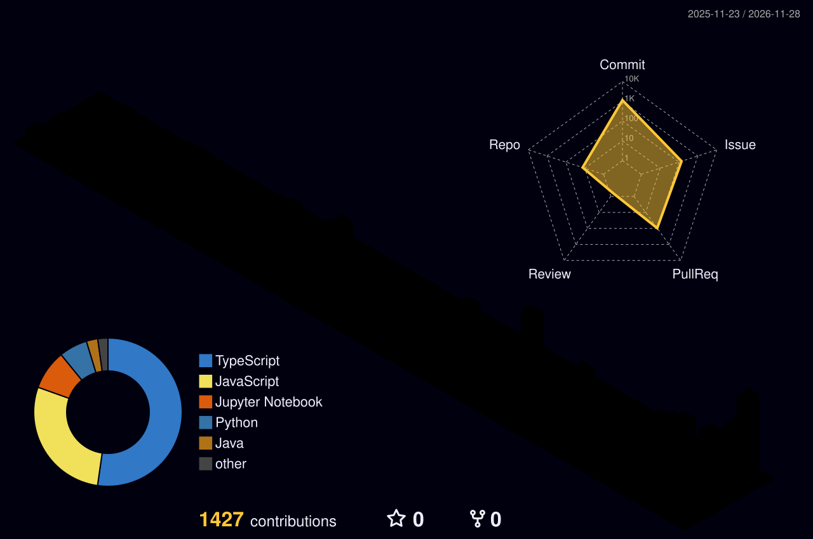

Making capable AI agents easy to understand, guide, and work with.

## What I explore

<table>
<tr><td rowspan="4"><b>Verify</b></td><td><a href="https://github.com/leeeeeseojin/intentguard">IntentGuard</a></td><td>E2E testing for Agent UX</td></tr>
<tr><td><a href="https://github.com/leeeeeseojin/agent-judge-study">agent-judge-study</a></td><td>Do LLM judges catch agents that falsely report success?</td></tr>
<tr><td><a href="https://github.com/leeeeeseojin/agent-a11y-gap">agent-a11y-gap</a></td><td>What browser agents see vs. what screen readers see</td></tr>
<tr><td><a href="https://github.com/leeeeeseojin/codemode-exposure-gap">codemode-exposure-gap</a></td><td>What Code Mode agents leak beyond the sandbox</td></tr>
<tr><td><b>Understand</b></td><td><a href="https://github.com/leeeeeseojin/my-dugout">MY DUGOUT</a></td><td>AI coach that explains its calls</td></tr>
<tr><td><b>Control</b></td><td><a href="https://github.com/leeeeeseojin/deallens">DealLens</a></td><td>Negotiation agent you can take over</td></tr>
<tr><td><b>Connect</b></td><td><a href="https://github.com/leeeeeseojin/26-2_Daybit_FE">Daybit</a></td><td>Team-built study app connected to AI via MCP</td></tr>
</table>

## Languages

      

